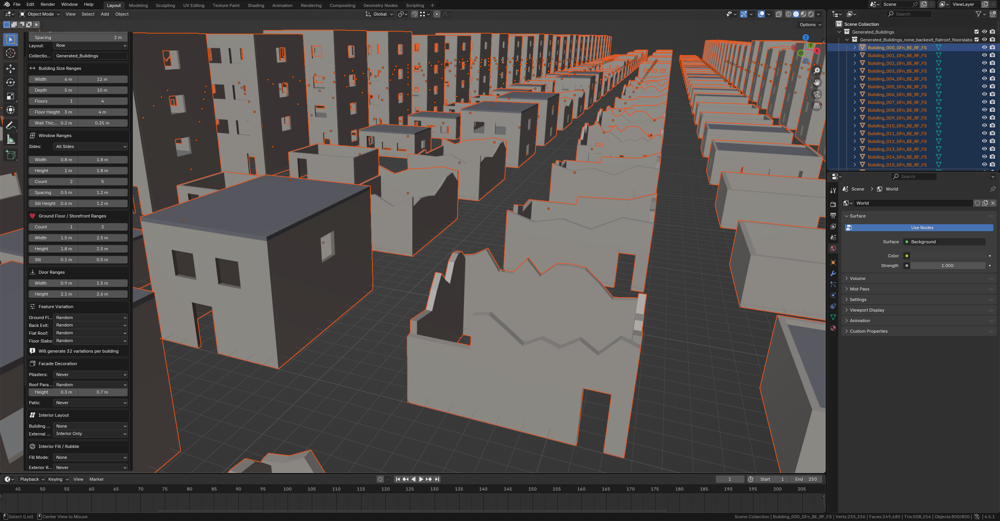

# Procedural Building Shell Generator

## v0.10.1: Collapse variety

Collapsed buildings now pick one of seven archetypes by seed: corner, stepped
(breaking storey by storey), shear (a side sliced off on a diagonal), cleave
(split along a plan diagonal), sawtooth (several roofline bites), gutted
(facades standing, floors fallen in) and blowout (multi-storey holes blown
through mid-height with the floors above intact). Collapses land on the tier
standing at their height, so setback towers break where their walls are.
Blast holes have ragged edges and spill debris to the street. Everything stays
watertight; every archetype is tested on four styles.

## v0.10.0: Closed-solid geometry, polygonal collapses, real floor plans

The geometry pipeline is rebuilt (see [ARCHITECTURE.md](ARCHITECTURE.md) for
the audit and design). Every wall, slab, partition and stair is now built as a
closed solid from its final outline, so damage of any shape cannot leave holes,
and no two faces z-fight. Tested on every style and condition: no open edges,
no flipped faces, no coplanar overlaps.

- **Damage.** Collapses are polygonal craters with sloped, jagged sides: facades
  break in diagonals and steps, floor slabs step back storey by storey along
  broken edges, and walls, slabs, partitions and stairs agree on what is
  missing. Exposed fills get jagged breaches; weathered facades get blast holes.
  Windows the break passes through are filled so ruins read as masonry.
- **Interiors.** Real floor plans: corridor apartment blocks with flats (hall,
  bath, kitchen, living room, bedroom), town-house walk-ups, shops either side
  of a stair hall, houses, office floors around a stair-and-lift core, warehouses
  and bars. Every room is reachable through a door the player fits through;
  partitions never land on a window.
- **Scale.** Sized for the Ares player: 1.2 x 2.3 m interior doors (were
  0.9 m and, upstairs, 1.95 m clear), 1.8 m corridors, 1.3 m stair flights,
  0.25 m slabs, taller ground floors for shops and lobbies, believable window
  heads, thick masonry for old town.
- **Towers.** Lobby types (grand double-height lobby with desk and canopy,
  retail podium, colonnade arcade, pilotis), curtain/ribbon/punched facades,
  podium and setback tiers, plant floors, stepped crowns, masts and plant rooms.
- **Operators.** The single-building operator adds Lobby, Facade, Taller Ground
  Floor, Cornices, Tower Core and the Office/House profiles; Generate Building
  by Style adds a Lobby override and up to 40 floors.
- Gable houses get a ceiling under the roof (the sky no longer shows through).
- Generation is pure Python up to the Blender adapter; `python3 -m unittest
  discover -s tests` checks real buildings without Blender.

## v0.9.9: Skyscraper cores

DOWNTOWN office towers now use a centered service core: two elevator shafts
at the front, a rear switchback stair, core doors, and stair/elevator slab
cutouts. Floor slabs support multiple openings. The core and stairs are built
even for shell-only skyscrapers; furnished office floors add the meeting room
and open plate around it. Wall tops and wall ends are capped at floor lines
and on weathered roof spikes.

## v0.9.8: Floor plates and wall tops

Non-interior lots now get solid floor plates instead of stair cutouts, while
interior lots get capped floor-cutout sides. Wall cells are capped at every
floor, vertical wall ends and spike tips are paired into caps, and small open
top loops are closed.

## v0.9.7: Wall shell repair

Damage and chunk cuts could remove a wall's inner facade while leaving the
outer face, opening the wall cavity to the interior. Surviving outer wall faces
are now mirrored inward wherever the inner face is missing, and the remaining
top edges are paired into wall caps.

## v0.9.6: Capped chunk cuts

Chunk removals are bisected exactly at their cut planes. Exposed floor-slab
edges, interior partitions and stair sections get cut caps; the exterior wall
thickness keeps its shelf cap, while open rooms intentionally stay open.

## v0.9.5: Window-clear interiors

Stair cores keep a 1 m aisle from side facades and stop 0.6 m clear of the
front/back window planes. Interior partitions are pulled 0.6 m clear of every
exterior opening, so office and storefront walls no longer sit in or directly
behind window reveals.

## v0.9.4: Interior fit-out

Interiors now use solid, capped wall boxes with real door openings and headers.
Apartment, office, house, storefront, warehouse and bar profiles place their own
walls on every floor; the stair core gets a double-flight switchback with a
turning landing, solid steps and a matching floor-slab opening. Partitions that
would land in an exterior door or window are pulled clear instead of vanishing,
and the stair treads and wall caps survive mesh cleanup.

## v0.9.3: Failure-model ruins

New **Add → Mesh → Generate City** and **Generate Building by Style** commands
add seeded city growth, six district archetypes, connected road tiers, driving
circuits, sidewalks, curved corner fillets, foundations, density controls, and
preview/detailed output. Streets are tessellated from a distance field, so
junctions are the union of the curved corridors with no overlapping faces.
**File → Export → Generated City for Unity (.fbx)** exports the static city meshes.
The existing single
and bulk building commands remain available.

Buildings now fail the way neglected towers do: weathered tops, vertical
corner/bay slices, solid rubble fills behind intact facades, half-filled lower
floors, roofless shells, low wall rings with a mound inside, and full rubble
mounds. Loose debris is replaced by rubble mounds at cut bases and inside wall
rings, tall towers carry heavier damage, and filled states expose their rubble
through a ground-floor bay and an upper cut instead of looking empty. District weights decide how often each appears, and only a
configurable fraction of enterable buildings get full interior layouts. The
ground extends far past the city as open wasteland (default 12 km), so the
horizon reads as empty land while the game keeps the player inside invisible
walls. The radius control scales the city from a district to a metro; the demo
scene uses radius 14 (about 1.6 km across). Downtown gets tall glazed towers,
the midtown ring keeps old town, residential and brutalist blocks, industrial
edges get wide low sheds, and denser suburbs get small pitched-roof houses.

A Blender 4.5+ addon for generating game-ready building shells with customizable windows, doors, and optional post-apocalyptic damage. Perfect for creating urban environments for games.

  

## Features

- **Procedural Building Generation** - Create 1-10 floor urban building shells with a single click
- **Customizable Windows & Doors** - Control window types, sizes, spacing, and door placement
- **Storefront Mode** - Large display windows for ground floor retail spaces
- **Interior Layouts** - Real floor plans with doors, stair cores and lifts (Storefront, Warehouse, Residential, Office, House, Bar)
- **Damage System** - Ragged tops, polygonal collapses, breaches and blast holes, all watertight
- **Lobbies and Massing** - Grand lobbies, retail podiums, arcades, pilotis, setbacks and crowns
- **Facade Decoration** - Pilasters, cornices, canopies, roof parapets, and patios
- **Bulk Generation** - Generate multiple buildings with randomized parameters
- **Game-Ready Output** - Clean geometry with proper normals and UV seams
- **Material Slots** - Pre-configured slots for easy texturing

## Installation

1. Download the latest release (zip file)
2. In Blender, go to **Edit → Preferences → Add-ons**
3. Click **Install...** and select the downloaded zip file
4. Enable "Procedural Building Shell Generator" in the add-ons list

Or manually copy the `procedural_building_shell` folder to your Blender addons directory:
- **Windows**: `%APPDATA%\Blender Foundation\Blender\4.5\scripts\addons\`
- **macOS**: `~/Library/Application Support/Blender/4.5/scripts/addons/`
- **Linux**: `~/.config/blender/4.5/scripts/addons/`

## Quick Start

### Single Building
1. Press **Shift+A** → **Mesh** → **Procedural Building Shell**
2. Adjust parameters in the dialog
3. Click **OK** to generate

### Bulk Generation
1. Press **Shift+A** → **Mesh** → **Bulk Generate Buildings**
2. Set count, layout, and parameter ranges
3. Click **OK** to generate a collection of buildings

## Building Profiles

| Profile | Description |
|---------|-------------|
| **Storefront** | Retail front with back room, residential above |
| **Warehouse** | Large open space with optional office |
| **Residential** | Apartments with hallway |
| **Bar** | Multiple connected rooms for entertainment venues |

---

## Detailed Documentation

### Single Building Parameters

#### Basic Settings

| Parameter | Default | Description |
|-----------|---------|-------------|
| **Width** | 8.0m | Building width (X axis) |
| **Depth** | 6.0m | Building depth (Y axis) |
| **Floors** | 2 | Number of floors (1–4) |
| **Floor Height** | 3.5m | Height of each floor |
| **Wall Thickness** | 0.25m | Thickness of walls |
| **Taller Ground Floor** | 0.0m | Extra height of the ground storey (shops, lobbies) |

#### Ground Floor and Facade

| Parameter | Default | Description |
|-----------|---------|-------------|
| **Lobby** | None | Grand Lobby, Retail Podium, Arcade (colonnade) or Pilotis |
| **Facade** | Punched | Punched windows, Ribbon bands, Curtain Wall or Deep Grid |
| **Cornices** | Off | Bands at the first-floor line and below the roof |
| **Tower Core** | Off | Stair and lift core on every floor, even without an interior profile |

#### Window Settings

| Parameter | Default | Description |
|-----------|---------|-------------|
| **Window Type** | Rectangular | Style: Rectangular, Tall, or Square |
| **Window Width** | 1.2m | Width of each window |
| **Window Height** | 1.4m | Height of upper floor windows |
| **Windows Per Floor** | 3 | Number of windows on front/back walls |
| **Window Spacing** | 0.8m | Space between windows |
| **Sill Height** | 0.9m | Height of window sill from floor |

#### Storefront Settings (Ground Floor)

| Parameter | Default | Description |
|-----------|---------|-------------|
| **Storefront Ground Floor** | ✓ On | Enable larger storefront windows on ground floor |
| **Storefront Window Height** | 2.2m | Height of storefront windows |
| **Storefront Sill Height** | 0.3m | Lower sill for display windows |

#### Door Settings

| Parameter | Default | Description |
|-----------|---------|-------------|
| **Door Width** | 1.2m | Width of doors |
| **Door Height** | 2.4m | Height of doors |
| **Front Door Position** | 0.1 | Position along front wall (0=left, 1=right) |
| **Back Exit** | ✓ On | Add a back exit door |
| **Back Door Position** | 0.5 | Position along back wall |

#### Structure Options

| Parameter | Default | Description |
|-----------|---------|-------------|
| **Flat Roof** | ✓ On | Generate a flat roof |
| **Floor Slabs** | ✓ On | Generate floor slabs between floors |

> **Note:** When **Flat Roof** is disabled, walls automatically get top caps to close the geometry.

#### Damage Settings (Post-Apocalyptic)

| Parameter | Default | Description |
|-----------|---------|-------------|
| **Enable Damage** | Off | Master toggle for damage effects |
| **Damage Amount** | 0.3 | How far the top breaks down; above ~0.5 whole storeys go |
| **Pointiness** | 0.5 | Variation of the ragged wall tops |
| **Resolution** | 1.0 | Samples per 1.2 m along the broken tops |

Collapses (polygonal craters), breaches and blast holes come from the city and
style conditions (Semi-collapsed, Rubble-filled, ...). The ground storey never
breaks, so entrances stay usable.

#### Generation Settings

| Parameter | Default | Description |
|-----------|---------|-------------|
| **Random Seed** | 0 | Seed for deterministic generation |
| **Auto Clean** | ✓ On | Merge coplanar faces into n-gons (the mesh stays watertight) |
| **Create Material Slots** | ✓ On | Create material slots for easy texturing |

---

### Bulk Generation

Generate multiple buildings at once with randomized parameters.

#### Bulk Settings

| Parameter | Default | Description |
|-----------|---------|-------------|
| **Building Count** | 5 | Number of buildings to generate |
| **Spacing** | 2.0m | Space between buildings |
| **Layout** | Row | Arrangement: Row, Grid, or Random |
| **Grid Columns** | 3 | Columns when using Grid layout |
| **Random Area Size** | 50m | Area size when using Random layout |
| **Collection Name** | Generated_Buildings | Name of the collection for buildings |

#### Parameter Ranges

Define min/max values for randomized parameters:

| Range | Default Min | Default Max |
|-------|-------------|-------------|
| **Width** | 6.0m | 12.0m |
| **Depth** | 5.0m | 10.0m |
| **Floors** | 1 | 4 |
| **Floor Height** | 3.0m | 4.0m |

Buildings are generated with random values within these ranges, each with a unique seed based on the **Base Seed** + building index.

---

### Material Slots

When **Create Material Slots** is enabled, the addon creates 5 material slots:

| Slot | Material Name | Default Color | Usage |
|------|---------------|---------------|-------|
| 0 | Building_Walls | Concrete (tan) | Exterior walls |
| 1 | Building_Floor | Gray | Floor slabs |
| 2 | Building_Roof | Dark gray | Roof |
| 3 | Building_WindowFrame | Brown | Window frame edges |
| 4 | Building_DoorFrame | Dark brown | Door frame edges |

Replace these placeholder materials with your own textures for production use.

---

### Building Styles

#### Small Storefront (Default)
- 2 floors, 8×6m footprint
- Storefront mode enabled
- Door offset to the left (0.1)
- Large ground floor windows, smaller upper floor windows

#### Residential Apartment
- Disable "Storefront Ground Floor"
- Increase floors to 3-4
- Center the front door (offset 0.5)
- Uniform window sizes across all floors

#### Abandoned/Damaged Building
- Enable damage, Damage Amount 0.3–0.6
- For collapses use **Generate Building by Style** with the Semi-collapsed,
  Shell or Rubble-filled condition

#### City Block (Bulk Generation)
- Use Bulk Generate with Grid layout
- 9–16 buildings (3×3 or 4×4 grid)
- Vary floors 1–4, widths 6–15m
- Enable storefront for ground floors
- Optional light damage for post-apocalyptic feel

---

### Tips

#### Deterministic Generation
- Use the **Random Seed** to get consistent results
- Same seed + same parameters = same building
- For bulk generation, Base Seed determines all building variations

#### Geometry Quality
- Every wall, slab, partition and stair is a closed solid: no holes, no
  flipped faces, no coplanar faces fighting (see ARCHITECTURE.md)
- **Auto Clean** merges coplanar faces into n-gons
- Opening reveals show the wall depth at windows/doors

#### Performance
- About 0.1 s for a mid-size building with interiors in Blender
- No modifiers or booleans

#### Game Engine Export
- Geometry is watertight (every edge shared by exactly two faces)
- Normals face outward
- Separate material slots for easy texturing
- Export via **File → Export → FBX** (or your preferred format)

#### Customization Workflow
1. Generate building(s) with desired parameters
2. Apply materials/textures to each slot
3. Optionally apply modifiers (Bevel, Subdivision) for higher detail
4. Export to game engine

---

### Troubleshooting

#### Windows Overlapping or Missing
- Reduce **Windows Per Floor** or increase building **Width**
- Increase **Window Spacing**
- Windows automatically avoid door positions

#### Door Not Visible
- Ensure **Door Height** is less than **Floor Height**
- Check **Front Door Position** isn't pushing door off the wall

#### Damage Looks Too Extreme
- Lower **Damage Amount**; below about 0.3 only the parapet breaks

#### Materials Not Appearing
- Ensure **Create Material Slots** is enabled
- Check viewport shading mode (Material Preview or Rendered)

#### Bulk Buildings Overlapping
- Increase **Spacing** value
- Use Grid layout for predictable arrangement
- Reduce parameter ranges so building sizes are more consistent

---

### Changelog

#### v0.2.0
- Added **Bulk Generate Buildings** operator
  - Row, Grid, and Random layouts
  - Parameter ranges for width, depth, floors, floor height
  - Generates buildings into a named collection
- Added **wall top caps** when roof is disabled
- Improved geometry cleanup (edge dissolution for cleaner meshes)
- Fixed floor connection seams

#### v0.1.0
- Initial release
- Procedural wall generation with window/door cutouts
- Storefront mode for ground floor
- Configurable damage system
- Material slot creation
- Full operator UI with organized parameter groups

---

## License

GPL-3.0-or-later - Compatible with Blender's licensing.

See [LICENSE](LICENSE) for details.

## Contributing

Contributions are welcome! Please feel free to submit issues or pull requests.

## Credits

Originally developed for **Ares**, a first-person boomer shooter game.
