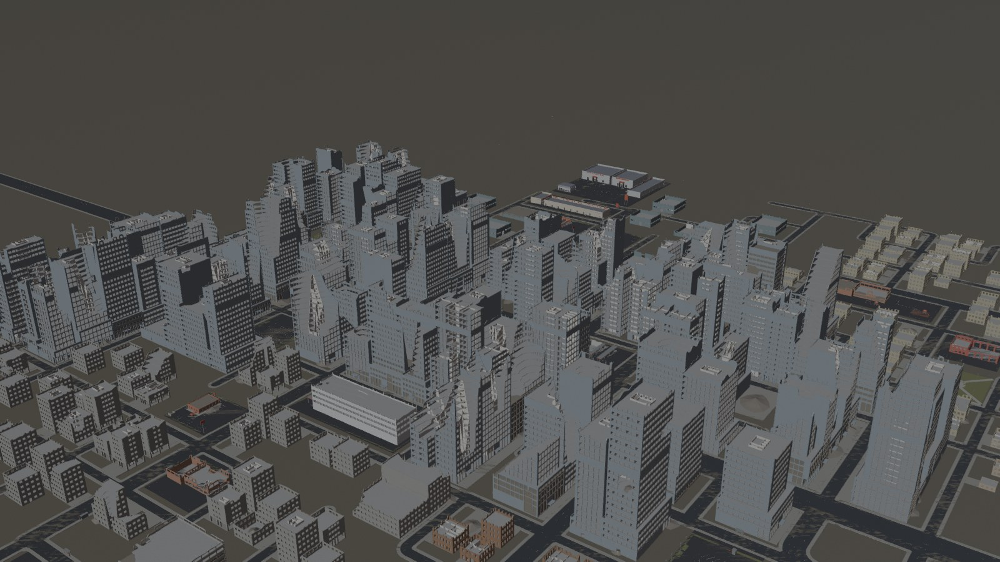
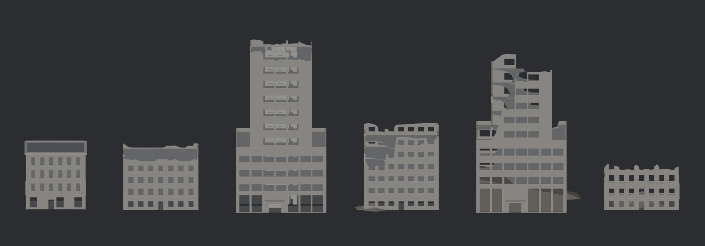
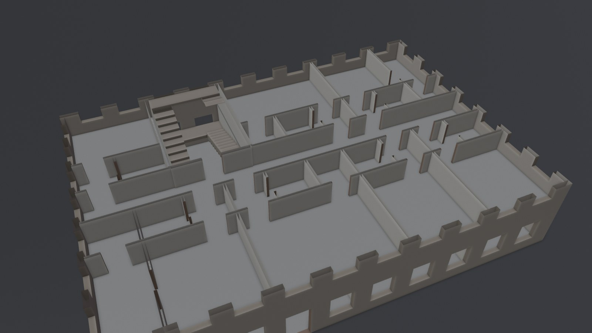
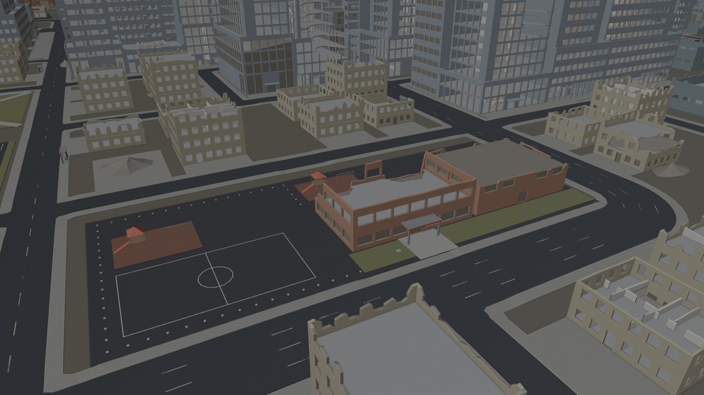
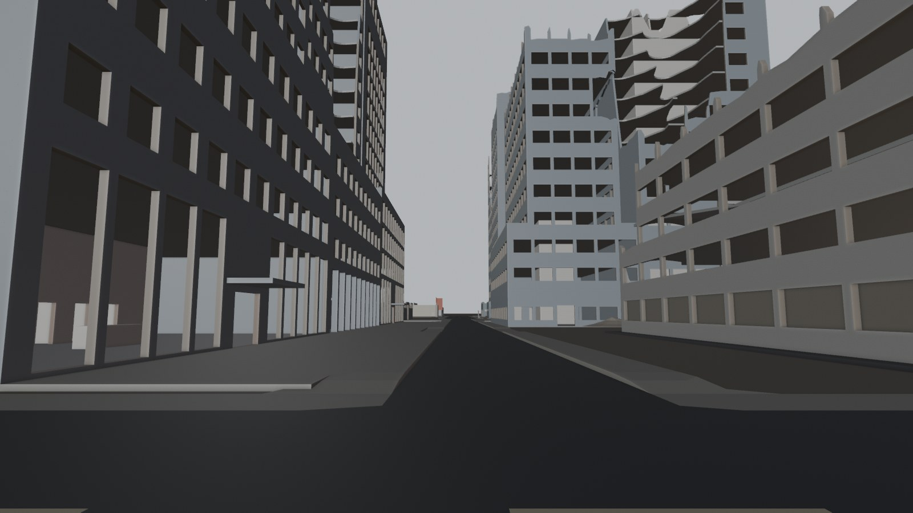

# Procedural Building Shell Generator

A Blender add-on that generates game-ready buildings and whole ruined cities:
closed-solid building shells with real floor plans, nine damage and collapse
states, points of interest such as gas stations and schools, a street network
with driving circuits, and an FBX export with JSON metadata for Unity.

It was built for **Ares**, a first-person boomer shooter, and everything is
sized for the game's 2 m player capsule.

  

## Features

- **Six district styles.** Downtown towers (lobbies, retail podiums,
  arcades, pilotis, setbacks, crowns), old town, residential and brutalist
  blocks, industrial sheds and suburban houses.
- **Real interiors.** Floor plans for apartments, shops, offices, houses,
  warehouses and bars. Every room can be reached through a door the player
  fits, stairs can be climbed (stacked flights keep their headroom), and
  towers get stair-and-lift cores.
- **Damage that holds together.** Nine conditions from intact to collapsed,
  seven collapse archetypes, blast holes, rubble fills and mounds. Broken
  tops keep the window grid. Every wall, slab, partition and stair is a
  closed solid: no holes, no flipped faces, no z-fighting.
- **Cities.** Seeded district growth, curved roads with filleted junctions
  and connected driving circuits, footways and curbs, built-out suburbs with
  houses round their cul-de-sacs, a dense downtown of party-walled towers
  and superblocks, and highways that run out into the wasteland. A **Small
  Town** preset builds a rural town instead: an old-town main street, low
  houses round it and only the sites a town has.
- **Points of interest.** Eighteen kinds of site, each with two to four
  layouts: gas stations, fast food, auto repair, schools, hospitals, police
  and fire stations, transit stations, parks, parking lots and garages, strip
  malls, shopping plazas, enclosed malls, hotels, motels, cinemas and
  drive-in cinemas, with the other retail gathered round the mall. Transit
  stops stand along the footways.
- **Unity export.** A city-only FBX (metre scale, Y-up, triangulated) and a
  `.city.json` with roads, junctions, buildings and their entrances, sites,
  and markers for game assets (props, trees, fences, flagpoles, parking
  stalls, counters and desks). Every building also lists its rooms to furnish
  (doors, windows, blank wall runs), its lifts (shaft, doors, car) and its
  railings, since furniture, railings and lift parts are game assets. C#
  classes for `JsonUtility` are included.
- **Deterministic.** The same seed and settings give the same result. The
  generator is pure Python up to a thin Blender adapter.

  

  
  

## Requirements

Blender 4.5 or later. Development and testing use Blender 5.1; 4.5 is the
declared minimum and is not tested separately.

## Installation

1. Download `procedural_building_shell_vX.Y.Z.zip` from the
   [releases](https://github.com/outerreaches/blender-building-generator/releases).
2. In Blender, open **Edit > Preferences > Add-ons**, choose **Install from
   Disk**, and select the zip.
3. Enable **Procedural Building Shell Generator**.

To install from a clone instead, copy the repository folder into Blender's
add-ons directory **named `procedural_building_shell`**. Blender imports the
folder by name, so the folder name GitHub gives a downloaded archive will not
load.

**Updating:** Blender only reloads part of an add-on when you install over an
enabled copy. Remove the old version, install the new one and restart
Blender. Every generated city and building records the `addon_version` that
made it.

## Quick start

All generators are in the 3D viewport under **Shift+A > Mesh**:

| Command | What it makes |
| --- | --- |
| **Generate City** | A whole city: streets, districts, buildings, sites and transit stops |
| **Generate Building by Style** | One building in a district style and condition |
| **Generate Site (Point of Interest)** | One site: its pad, buildings and props |
| **Procedural Building Shell** | One building from explicit parameters |
| **Bulk Generate Buildings** | A row, grid or scatter of randomised buildings |

To make a city:

1. **Shift+A > Mesh > Generate City.** Pick the **Preset** (City or Small
   Town), and keep **Output** on **Layout Preview** while you tune the seed,
   radius and density; it is fast.
2. Switch **Output** to **Detailed Shells** for windows, doors, floors,
   damage and interiors. Both use the same plan.
3. Export with **File > Export > Generated City for Unity (.fbx)** and pick
   the city's root collection. The exporter writes the FBX and the metadata
   (`<name>.city.json`) beside it.

Each run creates a new collection at the 3D cursor. Undo removes the run, and
a failed run removes its own objects.

  

## Documentation

- [CITY_GENERATOR.md](CITY_GENERATOR.md): the city generator's controls,
  districts, conditions, sites, street geometry, the Unity export and the
  metadata format.
- [ARCHITECTURE.md](ARCHITECTURE.md): how buildings are built, the rules the
  geometry keeps, the damage model, interiors and dimensions.
- [CHANGELOG.md](CHANGELOG.md): what changed in each version.
- [ROADMAP.md](ROADMAP.md): what is planned.
- [docs/unity/CityMetadata.cs](docs/unity/CityMetadata.cs): C# classes for
  reading the city metadata in Unity.

## Generate Building by Style

| Parameter | Default | Description |
| --- | --- | --- |
| **Architecture** | Downtown Tower | Downtown Tower, Old Town / Masonry, Residential, Brutalist, Industrial or Suburban House |
| **Width / Depth** | 14 / 12 m | Footprint, 6-100 m |
| **Floors** | 3 | 1-40 |
| **Condition** | Intact | Intact, Weathered, Semi Collapsed, Rubble Filled, Partial Filled, Lower Floors, Shell, Wall Ring or Collapsed |
| **Damage** | 0.35 | How far the damage goes; each condition also sets a minimum |
| **Interiors** | Off | Full floor plans, for conditions that can be entered |
| **Lobby** | Auto | Override the tower lobby: None, Grand Lobby, Retail Podium, Arcade or Pilotis |
| **Seed** | 42 | Varies massing, openings and damage |

The conditions are described in
[CITY_GENERATOR.md](CITY_GENERATOR.md#building-conditions).

## Generate Site (Point of Interest)

| Parameter | Default | Description |
| --- | --- | --- |
| **Site** | Gas Station | One of the eighteen kinds |
| **Layout** | (per kind) | The kind's layouts, for example Back or Side for a gas station; in a city, cinemas and hotels pick the one that suits their district |
| **Width (along street) / Depth** | 40 / 40 m | Pad size, 16-160 m; each kind has a minimum |
| **Condition / Damage** | Intact / 0.35 | As for buildings; props fixed to a building go with it |
| **Front Approach** | 2 m | Paved apron between the pad and the street |
| **Small Props** | On | Model benches, pumps, lamps, bollards and similar props. Off: they are only recorded as markers |
| **Water** | Off | Model water in fountains and other basins. Off: they are dry, and each water surface is recorded as a marker |
| **Output** | Detailed Shells | Or Layout Preview |
| **Seed** | 42 | Varies the layout |

The site kinds, their layouts and minimum pad sizes are listed in
[CITY_GENERATOR.md](CITY_GENERATOR.md#points-of-interest).

## Procedural Building Shell

The single-building operator exposes every parameter directly.

### Size and structure

| Parameter | Default | Description |
| --- | --- | --- |
| **Width / Depth** | 8 / 6 m | Footprint, 2-50 m |
| **Floors** | 2 | 1-10 |
| **Floor Height** | 3.5 m | 2.5-6 m |
| **Taller Ground Floor** | 0 m | Extra height for the ground storey (shops, lobbies) |
| **Wall Thickness** | 0.25 m | 0.1-1 m |
| **Flat Roof / Floor Slabs** | On / On | Without a roof the walls get top caps |

### Facade

| Parameter | Default | Description |
| --- | --- | --- |
| **Facade** | Punched | Punched windows, Ribbon bands, Curtain Wall or Deep Grid |
| **Lobby** | None | Grand Lobby, Retail Podium, Arcade (colonnade) or Pilotis |
| **Window Type** | Rectangular | Rectangular, Tall or Square |
| **Window Width / Height** | 1.2 / 1.4 m | Upper-floor windows |
| **Windows Per Floor / Spacing** | 3 / 0.8 m | On the front and back walls |
| **Sill Height** | 0.9 m | Above the floor |
| **Window Sides** | All Sides | Which walls get windows |
| **Ground Floor Windows** | Storefront | No Windows, Regular, Storefront or Wide Storefront, with their own count, width, height and sill |
| **Cornices** | Off | Bands at the first-floor line and under the roof |
| **Facade Pilasters** | Off | Corners only, corners and centre, between windows or full coverage, on chosen sides |
| **Roof Parapet** | Off | With its height |
| **Has Patio** | Off | A patio on one side with its own door |

### Doors

| Parameter | Default | Description |
| --- | --- | --- |
| **Door Width / Height** | 1.2 / 2.4 m | Street doors |
| **Front Door Position** | 0.1 | Along the front wall (0 left, 1 right) |
| **Back Exit / Position** | On / 0.5 | A back door |

### Interior

| Parameter | Default | Description |
| --- | --- | --- |
| **Building Profile** | None | Storefront, Warehouse, Residential, Office, House or Bar/Entertainment floor plans |
| **Tower Core** | Off | A stair and lift core on every floor, even without a profile |
| **External Stair Access** | Off | A door for an outside stair (the stair itself is not modelled) |
| **Interior Fill** | None | Completely or partially filled with rubble, or rubble piles, with filled floors and density |
| **Exterior Rubble** | Off | Rubble piles around the building |

### Damage

| Parameter | Default | Description |
| --- | --- | --- |
| **Enable Damage** | Off | Turns damage on |
| **Damage Amount** | 0.3 | How far the top breaks down; above about 0.5 whole storeys go |
| **Pointiness** | 0.5 | Variation of the ragged tops |
| **Resolution** | 1.0 | Samples per 1.2 m along the broken tops |

The ground storey never breaks, so entrances stay usable. Collapses, blast
holes and rubble fills come from the conditions of **Generate Building by
Style** and the city.

### Output

| Parameter | Default | Description |
| --- | --- | --- |
| **Random Seed** | 0 | Same seed and parameters give the same building |
| **Auto Clean** | On | Merges coplanar faces into n-gons; the mesh stays watertight |
| **Create Material Slots** | On | See below |
| **Mark UV Seams / Auto Unwrap UVs** | On / On | UVs ready for texturing |

## Bulk Generate Buildings

Generates a collection of buildings in a row, a grid or a random scatter. You
set the count, spacing and layout; a minimum and maximum for each size,
window, door, storefront, pilaster, parapet, patio, fill and damage setting;
and **Always**, **Never** or **Random** for each optional feature. Each
building's seed is the **Base Seed** plus its index.

## Materials

Buildings get eight slots: `Building_Walls`, `Building_Floor`,
`Building_Roof`, `Building_WindowFrame`, `Building_DoorFrame`,
`Building_InteriorWall`, `Building_Stairs` and `Building_Rubble`. Sites add
`Site_*` slots (asphalt, concrete, paint, grass, metal, signs, glass and
others) and a wall colour per kind. Streets use `City_Asphalt`,
`City_Pavement`, `City_Curb`, `City_Ground`, `City_LanePaint` and
`City_WornPaint`. The colours are placeholders: replace them with your own
materials.

## Geometry

- Buildings and site grounds are closed solids: each edge is shared by
  exactly two faces and normals face outward. Street surfaces are open
  underneath.
- No modifiers or booleans; meshes are built from their final outlines.
- Buildings, sites and street layers are separate objects, ready for culling.
- See [ARCHITECTURE.md](ARCHITECTURE.md) for how this is kept.

## Troubleshooting

- **A fix doesn't show after updating.** Restart Blender: an add-on
  installed over an enabled copy keeps running the old modules. Check the
  `addon_version` custom property on the city collection or building.
- **Windows overlap or are missing.** Reduce **Windows Per Floor** or
  **Window Spacing**, or widen the building. Windows avoid doors.
- **Damage looks too extreme.** Lower **Damage Amount**; below about 0.3
  only the parapet breaks.
- **Large cities are slow.** Tune them with **Layout Preview** and use the
  **Building Budget** to cap the number of detailed buildings.

## Development

The generator is pure Python up to the Blender adapter (`mesh_builder.py`,
`building_assets.py` and the operators), so buildings, sites and city plans
can be generated and checked without Blender. The project's test suite isn't
published in this repository yet.

## License

GPL-3.0-or-later, compatible with Blender's licensing. See [LICENSE](LICENSE).

## Contributing

Issues and pull requests are welcome; see [CONTRIBUTING.md](CONTRIBUTING.md).

## Credits

Developed for **Ares**, a first-person boomer shooter.
